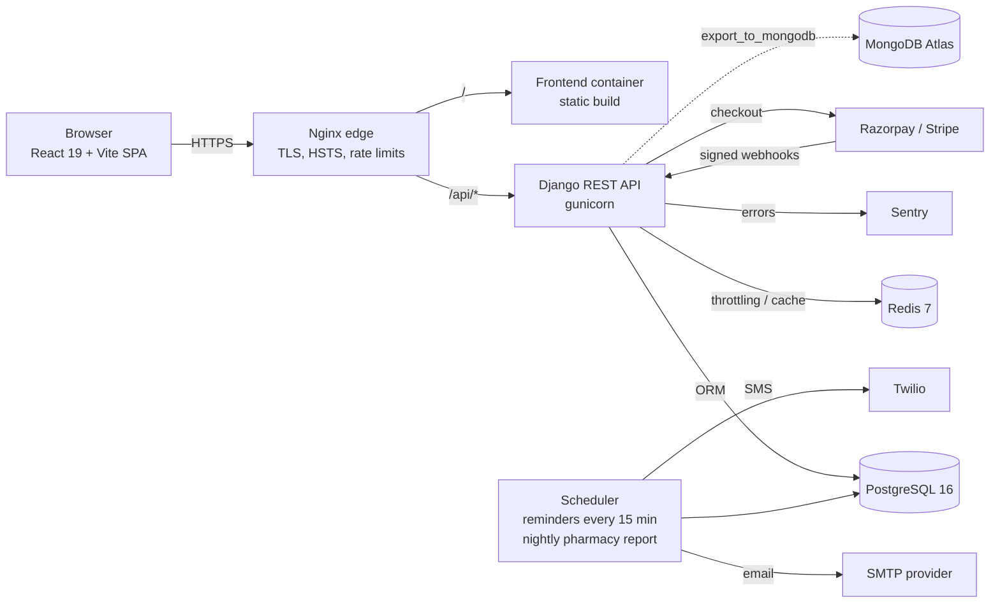

# MedCore HMS architecture

GitHub renders the Mermaid diagrams below. For PNG/SVG exports, paste them into https://mermaid.live.

## System components and data flow

## Request path and security layers

1. **Nginx** terminates TLS, redirects HTTP to HTTPS, applies edge rate limits and security headers.
2. **CORS** allows only the origins in `CORS_ALLOWED_ORIGINS`.
3. **JWT authentication.** Access tokens last 15 minutes. Refresh tokens last 7 days, are rotated on every use and blacklisted after rotation and on logout. A password change revokes every token issued before it.
4. **Throttling.** Authentication endpoints allow 100 requests per 15 minutes per IP; the rest of the API allows 1000 requests per minute.
5. **Role permissions.** Each view checks the caller's role. Querysets are filtered per role and per hospital, so a guessed record ID returns 404.
6. **Audit middleware** records every POST, PUT, PATCH and DELETE with the user, IP address, path, status and time.

## Multi-tenancy

The system uses **row-level tenancy**. Users and patients carry a `hospital` foreign key. `visible_patients()` and `tenant_scope()` restrict every patient-derived query to the caller's hospital. Super Admins work across hospitals. Legacy rows created before hospitals existed (`hospital = NULL`) stay visible so earlier data is not lost.

Row-level tenancy suits this scale: one database, simple migrations, and isolation enforced in one place. `test_tenancy_isolation` covers it.

## Concurrency (double booking)

Appointments carry two partial unique constraints: (doctor, date, time) and (patient, date, time), each excluding cancelled and no-show visits. Serializer validation gives friendly errors. When two requests race past validation, the database rejects the second insert and the API returns `400 "This appointment slot was just booked."` Rescheduling and lab, pharmacy and billing transitions use `SELECT … FOR UPDATE` (pessimistic locking).

## Role matrix (summary)

| Capability | Super Admin | Admin | Doctor | Nurse | Reception | Lab Tech | Pharmacist | Accountant | Patient |
|---|---|---|---|---|---|---|---|---|---|
| Hospitals onboarding | ✔ | own | | | | | | | |
| Patients | all | hospital | own patients | hospital | hospital | with lab orders | with Rx | hospital | self |
| Appointments | | ✔ | own | | ✔ | | | | own (book) |
| Medical records (append-only) | | create | view own | view | | | | | view own |
| Vitals | | ✔ | ✔ | ✔ | | | | | |
| Lab workflow | | ✔ | order / approve | | | process / approve* | | | approved only |
| Pharmacy inventory and dispensing | | ✔ | search | | | | ✔ | | |
| Invoices and line items | | ✔ | view | | create | | | ✔ | view / pay |
| Insurance claims | | ✔ | | | view | | | ✔ | view |
| Revenue analytics | ✔ | ✔ | | | | | | ✔ | |
| Audit log | ✔ | ✔ | | | | | | | |

\* A lab technician cannot approve a result they entered; a second technician or a doctor must approve it.
