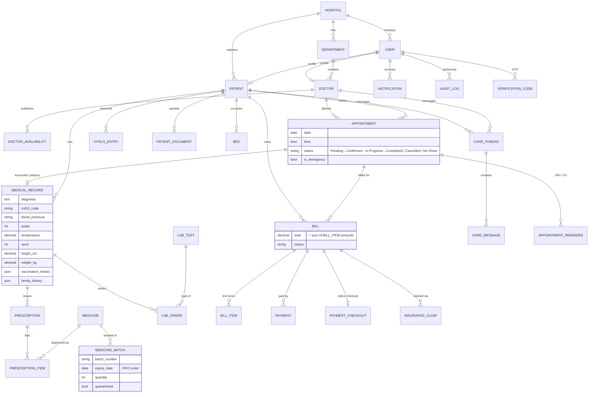

# MedCore HMS entity-relationship diagram

This diagram is generated from `backend/api/models.py`. Imported CSV admissions (`ImportedAdmission`) are a standalone historical table, with only an optional link to a doctor.

## Key decisions

- **Doctor availability**: dated time windows (`DoctorAvailability`) rather than a repeating weekly rule. This is simple to query and makes one-off leave easy, at the cost of publishing each day.
- **Prescription ↔ medicine**: `PrescriptionItem` holds the per-item dosage, frequency and duration, plus how much was dispensed and when.
- **Lab results**: hybrid. A structured value is compared automatically against the test's `low-high` reference range, with free-text notes and an optional report URL alongside it.
- **Soft deletes and retention**: `Patient`, `Doctor` and `Appointment` have `deleted_at`. Patients, medical records and vitals cannot be deleted at all (`pre_delete` raises `ProtectedError`).
- **Indexes**: foreign keys (hospital, patient, doctor) are indexed by Django. `Appointment(date, time)`, `MedicineBatch.expiry_date` and `ImportedAdmission.admission_date` are indexed explicitly.
